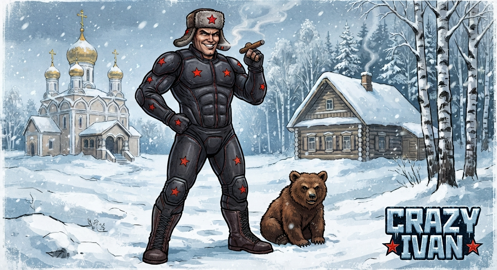

# NIC-Crazy_Ivan

**English** · [Čeština](README.cs.md) · [Русский](README.ru.md)

**A neural suit:** up to 582 electrodes and 98 inertial units, 56 of them in the gloves and the
socks, on a suit you put together from pieces like a sleeve, a trouser leg, the torso or a
headband.

The muscles' own signals and the body's motion go to a computer in the backpack, a Radxa ROCK 5T
with its own NPU or up to two Hailo-10H AI accelerators, and the whole body becomes the
controller for a computer or a game.

**Coming soon™.** Well — not *that* soon.

> **Beta 0.6:** a concept at the design stage, nothing is built yet; what is closed, what is
> open and what is only an estimate is under [Status](STATUS.md).

---

## What it is

A suit covered in electrodes and motion sensors. It is made of pieces: a sleeve, a trouser
leg, the torso, a headband around the head and more. Each piece is a module of its own, and you
can join pieces in any combination. A bigger suit is simply more pieces on the same bus. Each
wearer takes only the pieces that make sense for them, a quadriplegic for instance. It measures
the body alone, the muscles (EMG) and the motion (IMUs), on one time base.

## What it is for

- **First, a controller.** The one thing every suit needs is the detecting unit,
  [Baťa](bata/README.md), and he acts only as a controller, so the suit can be connected to a
  computer, a smart TV, anything; the computer worked on is Borovičok. Playing games, drawing in
  AutoCAD, programming, writing messages: all of it standing, walking in a meadow, on a park
  bench.
- **Second, rehabilitation.** A suit that precise can catch the signals of an injured or disabled
  person's muscles; a doctor sees them, says what they show and sets the load, this arm more,
  that less. An aid beside the doctor, not a certified medical device.
- **Beside them, the assistants** (below), programs on Baťa that use the headband.

**How we know it works:** as a controller, the wearer does real work in place of a mouse and a
keyboard, draws a part in AutoCAD, writes a message, plays a game, standing and walking alike,
and after each putting on a short calibration is enough, since the suit is never put on the same
way twice; for rehabilitation, a doctor tells from the record which muscle works and how hard,
side against side and day against day, and it agrees with what the doctor finds by examining.

**What it must do,** in ranges: the EMG at 1,920 SPS, its band to ~500 Hz, the professionals' rate,
3,840 SPS a setting to try for fast movements in sport and for the twitches of a nervous system that
does not work as it should; the IMUs in steps of 120 Hz; tens of milliseconds at most from a muscle
to the output; gestures for a computer and the joints' angles, wrong by units of degrees; a
calibration of a few minutes at most; a working day, ~8 h, on one charge in the smaller fittings;
sweat and light rain, not immersion. The weight and the price are to be seen.

## Tomography

"Tomography", in quotes: not every electrode against every other, which no eight channels could
give, but channels that each take a mix of muscles. A channel's two electrodes lie 4–8 cm apart
where the muscle allows, on neighbouring muscles or along one, along the fibres and across them
by turns, and across the spine only diagonally, so that the chords cross; farther apart they
would gather more crosstalk and, on the trunk, more of the heart. Against a reference electrode,
the second way on the same suit, every module's eight electrodes measure each against one point,
and any pair of them is formed in software. On the hand and the foot each pair sits on a muscle
of its own; the palm, the sole and the seat stay bare, as they are pressed on.

The reason is that you never put the suit on exactly the same way twice. So we don't follow an
exact point on the body. We follow how signals resemble each other and how they evolve. Whether
it works we do not know; studies suggest it might (see [Bogatyr](bogatyr/README.md)).

## Parts

| part | what it is |
|---|---|
| [**Rubaška**](rubaska/README.md) | the suit itself: the pieces with their sensing modules, the glove Vešč and the sock Nosok, the electrodes and the harness |
| [**Bogatyr**](bogatyr/README.md) | the layout on the body: where every electrode and IMU sits, muscle by muscle, and why |
| [**Nataša**](natasa/README.md) | the unit in the headband: headphones, two microphones, vibration and buttons |
| [**Mamka**](mamka/README.md) | the base board: the clock for the whole suit, the sound bridge, the line drivers and the suit's power |
| [**Baťa**](bata/README.md) | the computer in the backpack, a Radxa ROCK 5T, with Umnica, the Hailo-10H, or its own NPU alone |
| [**Terem**](terem/README.md) | the board under the ROCK 5T: its two Hailo-10H with a supply each |
| [**Babuška**](babuska/README.md) | the battery and its BMS, the hard-shell backpack, the power variants |
| [**Porjadok**](porjadok/README.md) | what holds for every module: processor, firmware, links between boards |
| [**software**](software/README.md) | the code: the protocols as Python codecs with tests, later the firmware and Baťa's programs |

## The family in the backpack

Mamka is Russian slang for a motherboard, and the rest of the backpack joined her family. The
names are Russian, written in Latin letters the Czech way:

| who | meaning | what it does |
|---|---|---|
| **Mamka** | mum | the base board: runs the suit and feeds her own children, the Rebjata |
| **Baťa** | dad, and in slang the boss | computer A: a ROCK 5T, with Mamka on his header |
| **Umnica** | the clever daughter | the Hailo-10H, who does the thinking for dad |
| **Terem** | the daughters' upper chamber | the board in the ROCK 5T's two M.2 slots: both Umnicas with a supply each |
| **Babuška** | grandma | the battery: she keeps the pantry, and everyone eats from her |
| **Ključnica** | the housekeeper with the keys | the BMS: she holds the keys to Babuška's pantry |
| **Kormilica** | the wet nurse | Mamka's power section: her supply, the lines' converters, the computers' eFuses |
| **Borovičok** | the old mushroom man, Babuška's husband | computer B, if wanted: a full computer beside Baťa over Ethernet, with the glasses and the programs |
| **Ďaďa Sem** | Uncle Sam, the uncle from America | the cameras that watch everything: two USB cameras into Baťa, read by his second Umnica, in the small and normal fittings by his own NPU |
| **Budilnik** | the alarm clock | the start button and its latch: one press wakes the household, and when everyone has shut down it lets the house go dark |
| **Storož** (Tron) | the night watchman | Baťa's halt daemon: on a fatal fault he stops the household's services, keeps the terminal open and says why |
| **Kommunalka** | a communal flat | the backpack: the whole family lives in it and shares one kitchen, Babuška |
| **Chodiki** | the wall clock with weights | the suit's clock, which the whole household lives by |

On the body, the suit is **Rubaška**, the shirt you are born in, on **Kaščej**, the harness; where
everything sits on it is **Bogatyr**, Kaščej dressed in the meat. Mamka's own children, the
**Rebjata** (the sensing modules), hang on the **Pupovina**, the umbilical cord: the eight lines,
one a piece of the suit, that bring power, the clock and data to them, to the gloves and to Nataša
and Míša. Every sensing unit's main processor is a **Staršaja**, the elder; the glove, **Vešč**,
and the sock, **Nosok**, have her younger brothers, the **Bratiški**, four small processors beside
her on one board, each reading a finger's IMUs.
The household's rules are the **Porjadok**, and its power, from Babuška down, the **Pitanije**.

The pieces combine freely:

| piece | variant | what it is |
|---|---|---|
| Baťa | *small* | Mamka on his header, the model on his own NPU, no Terem |
| Baťa | *normal*, *brutal* | Mamka on his header, Terem in his two slots with one or two Umnicas |
| the power | 5 A | the BMS lets out 5 A: Baťa alone |
| the power | 10 A | the BMS lets out 10 A: Baťa and Borovičok, with room to spare |

- **Baťa *small*, 5 A:** a small suit, a headband and a few modules, the least power.
- **Baťa with Terem, 5 A:** one or two Umnicas, and in his *brutal* fitting the whole system with
  glasses on his USB-C.
- **Baťa and Borovičok, 10 A:** Baťa runs only the suit, and Borovičok is a full computer with the
  glasses; the suit is his mouse and keyboard.

The details are under [Baťa](bata/README.md) and [Babuška](babuska/HARDWARE.md#power-variants), and
why each name under [Names](NAMES.md).

## Assistants

Nataša is the hardware in the headband; the assistants are programs on Baťa that use it, each
with a name of its own. They need no electrodes, so for them the headband and the backpack
(Mamka, Baťa and Babuška) are enough, without the sensing modules. Only
Míša adds hardware of his own: a unit on the forehead with a radar, ultrasound and an IMU, with a
place of his own on line 8 beside Nataša.

| assistant | what it does |
|---|---|
| [**Soňa**](sona/README.md) | for the deaf: listens all the time and tells by vibration what is happening around |
| [**Míša**](misa/README.md) | the watchdog: a radar and ultrasound watch for obstacles and warn through the headphones and the headband |
| [**Taťána**](tatana/README.md) | writes and reads: types what you dictate and reads text aloud, books included |
| [**Nikita**](nikita/README.md) | rhythm you can feel: the beat of the music as vibration |
| [**Pomoščnik**](pomoscnik/README.md) | the helper: looks at a part, reads its marking and finds it, with the glasses and the cameras |

They run as modes, switched on as needed. At a social event or anywhere with many people, and
when walking with a companion, Míša and Soňa stay off: the companion guides, close contact would
set Míša off all the time, and an alarm shows in how the people around react.

## Acknowledgements

To the AI assistant Claude (Anthropic), a big help in the whole project: the suit is designed
with AI, and these pages were written with it.

---

The software under the MIT licence, see [LICENSE](LICENSE); the hardware design, the pages and the
pictures, under the CERN-OHL-P v2, see [LICENSE-HW](LICENSE-HW).
