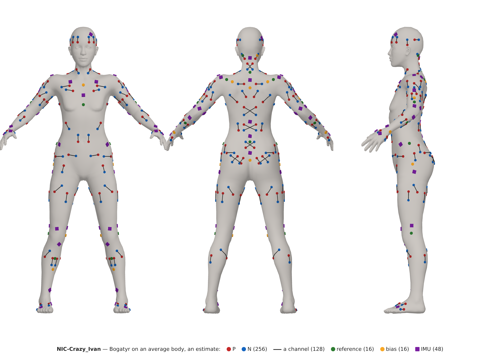
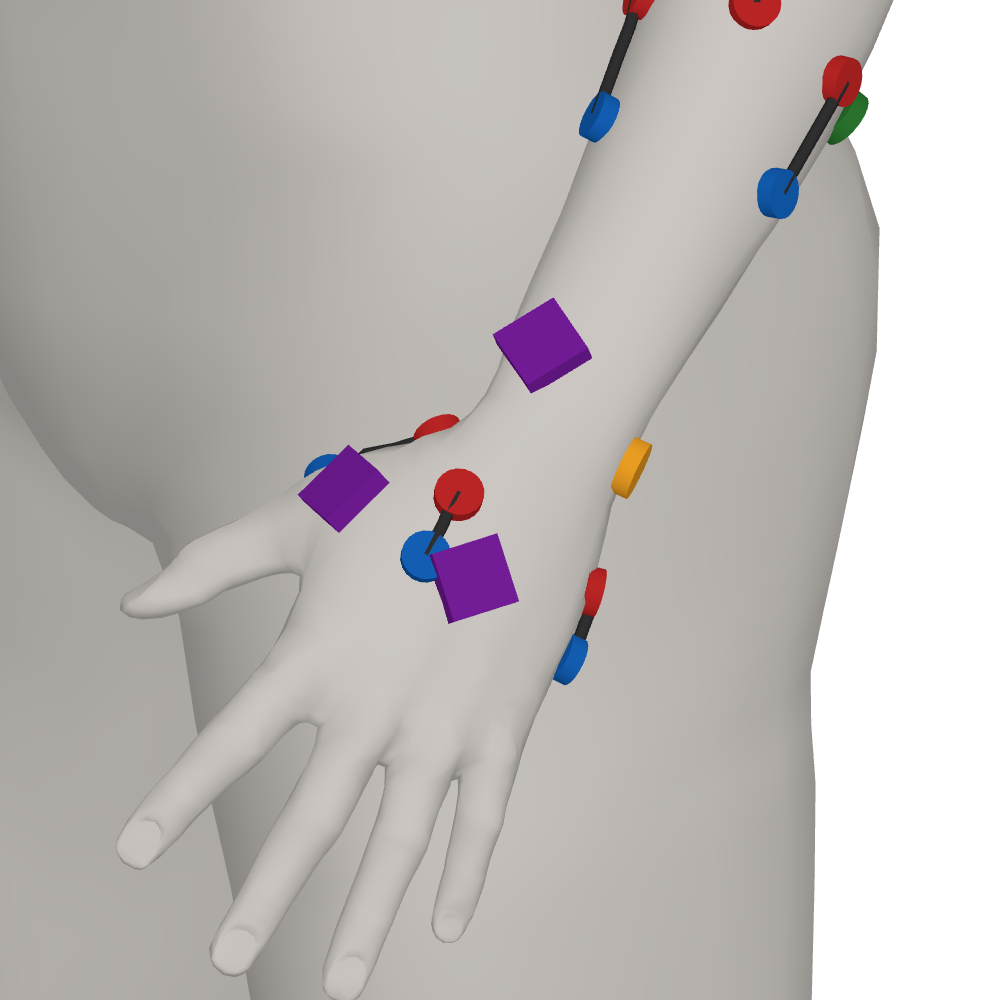
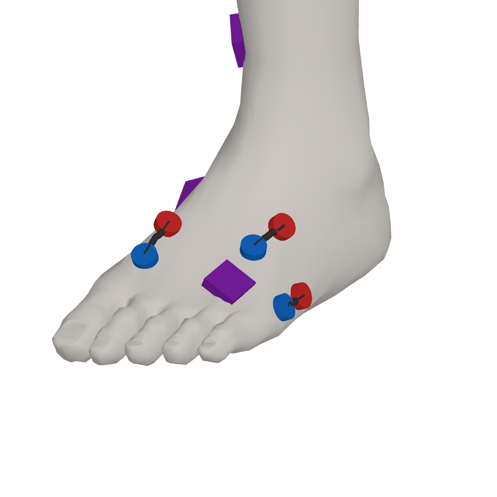
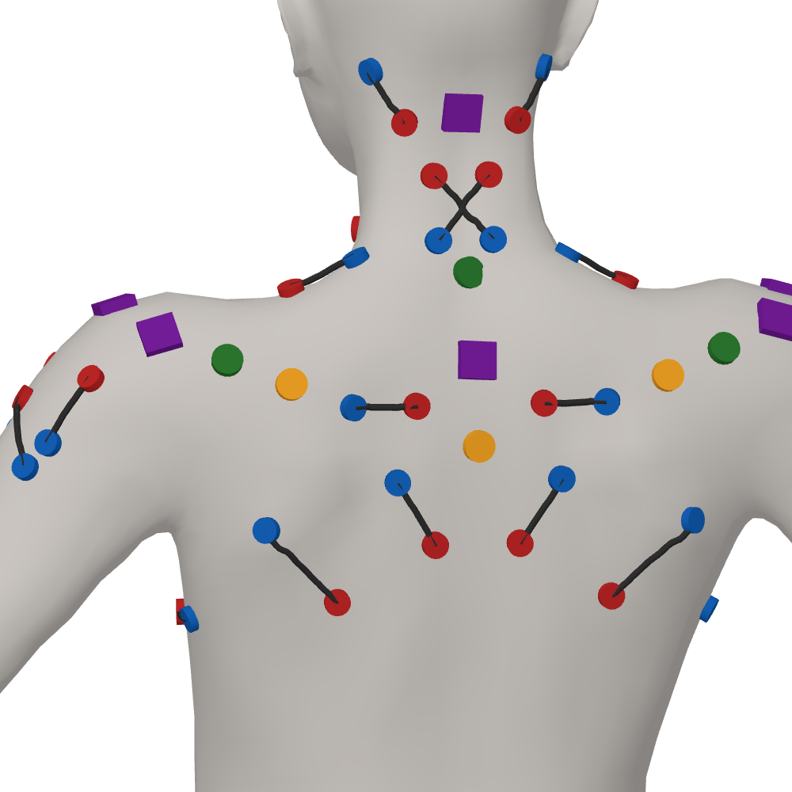

# Bogatyr

**The meat on Kaščej's bones:** where every electrode and every IMU sits on the body, and why.

↑ [NIC-Crazy_Ivan](../README.md)

---

*Bogatyr*, the strongman of the Russian byliny. Kaščej, the harness, is bone and skin (see
[Rubaška](../rubaska/CONSTRUCTION.md#harness-and-washing)); dressed in the electrodes on the
muscles and the IMUs on the bones, he is a bogatyr.

**A proposal, not yet tried on a body.** The layout is put together from several studies and anatomy
books, named where a place has one, and is to be gone through with someone who knows the body, a
physiotherapist, before any strip is drawn. Where a place is an estimate, it says so.

## What it lays out

- **The EMG of 16 modules,** every chip an ADS1298: fourteen of the body with two, 32 electrodes and
  a bias electrode each, measuring differentially, a channel P against N; the head's with two, 32
  electrodes, a bias and one reference electrode, the neck's with one and 16, both ways there,
  against the reference the P against one point, which the strip wires to the channels' negative
  inputs (see [Rubaška](../rubaska/HARDWARE.md#right-leg-drive)): 514 electrodes on the modules, and
  the hand's and the foot's sixteen with a bias on the glove's and the sock's own ADS1298, 582 in
  all. A channel's two electrodes lie 4–8 cm apart where the muscle allows, 2–3 cm on small muscles
  and near the heart, along the fibres and across them by turns, and across the spine only
  diagonally. **The body's modules' second eight channels are not laid out yet:** this page has the
  first eight of every module, and the rest is laid out with the physiotherapist (see
  [construction](CONSTRUCTION.md#open-questions)).
- **The IMUs,** 42 on the body of 64 places, two or more on each segment of a limb, more where
  the skin slides most and four in a square on the head; the gloves' 2 × 20 and the socks' 2 × 8.
- **What was left out,** the muscles surface EMG cannot reach and the places the body presses
  on, and the layouts before this one.

## On an average body

**A first draft,** drawn to see the layout whole, to be looked at with the layout by someone who
knows the body (see [construction](CONSTRUCTION.md#open-questions)).

Every place of [construction](CONSTRUCTION.md) put on MakeHuman's average body by the bones'
landmarks: P red, N blue, each channel a line between them, the reference green, the bias yellow,
the IMUs violet. The landmarks are estimates on that body, not measured (see
[software/body](../software/body/README.md)); the modules are not drawn, their places on the
trunk not being set. Up close, each with its own modules alone:

| the hand and the forearm | the foot and the calf | the neck, the upper back and the shoulders |
|---|---|---|
|  |  |  |

The hand and the foot are drawn with two IMUs each on their module; today they are the glove's and
the sock's, with more (see [construction](CONSTRUCTION.md#the-imus)), and the body's modules'
second eight channels are not drawn: the pictures wait for the layout's next round.

| file | what is in it |
|---|---|
| [CONSTRUCTION.md](CONSTRUCTION.md) | the electrodes' rules; the modules one by one, every muscle with its P and N, the reference and the bias; the IMUs' rules and places; the glove's |
| [WHY.md](WHY.md) | what was left out, and why; the layouts before this one |
| `body.png`, `hand.png`, `foot.png`, `neck.png` | the layout on an average body, a first draft, drawn by [software/body](../software/body/README.md) |

What the electrodes, the strips and the harness are made of is under
[Rubaška](../rubaska/CONSTRUCTION.md); the modules and the glove under
[Rubaška's hardware](../rubaska/HARDWARE.md).

## Scale

| | modules | electrodes | IMUs |
|---|---|---|---|
| the body | 16: the head, the neck with the upper back, the two shoulders, the chest with the abdomen, the lower back, the two hips, and two on each limb | 496, 32 on a module of the body and on the head's, 16 on the neck's; a bias electrode on every module and a reference on the head's and the neck's, 514 | 42 of 64 places |
| the gloves | one unit each, the hand's: an ADS1298 on the board | 2 × 17: sixteen and a bias | 2 × 20 |
| the socks | one each, the foot's | 2 × 17 | 2 × 8 |
