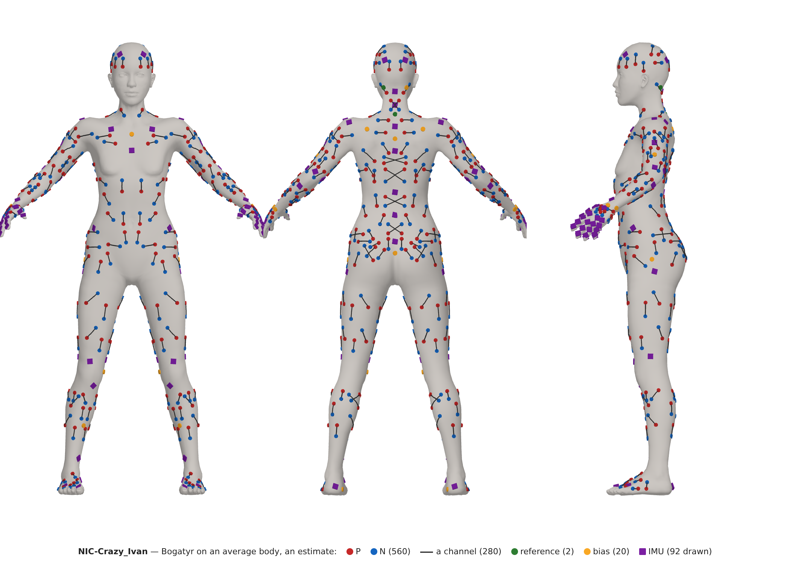
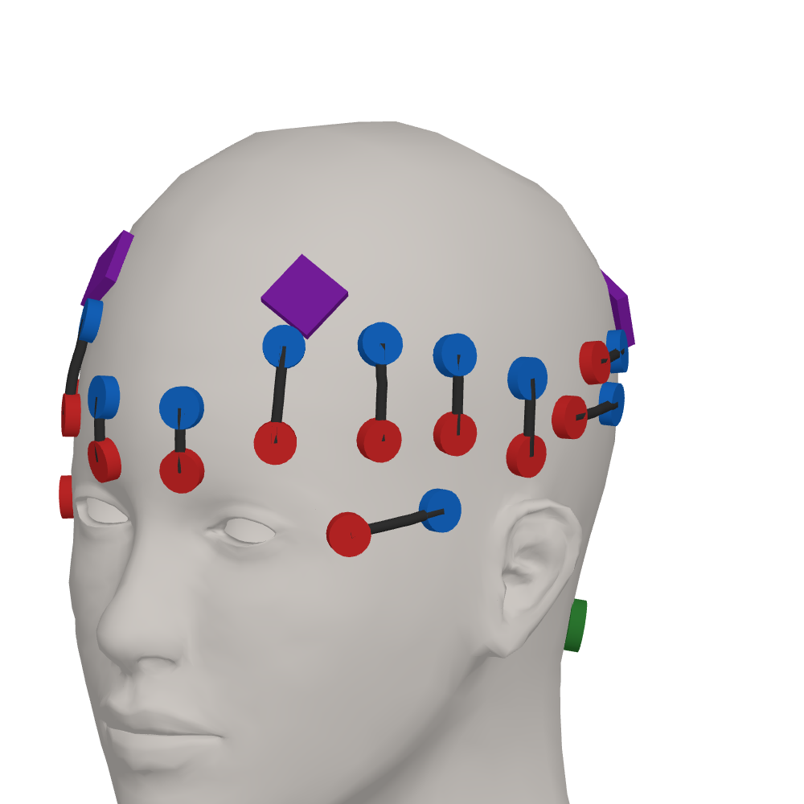
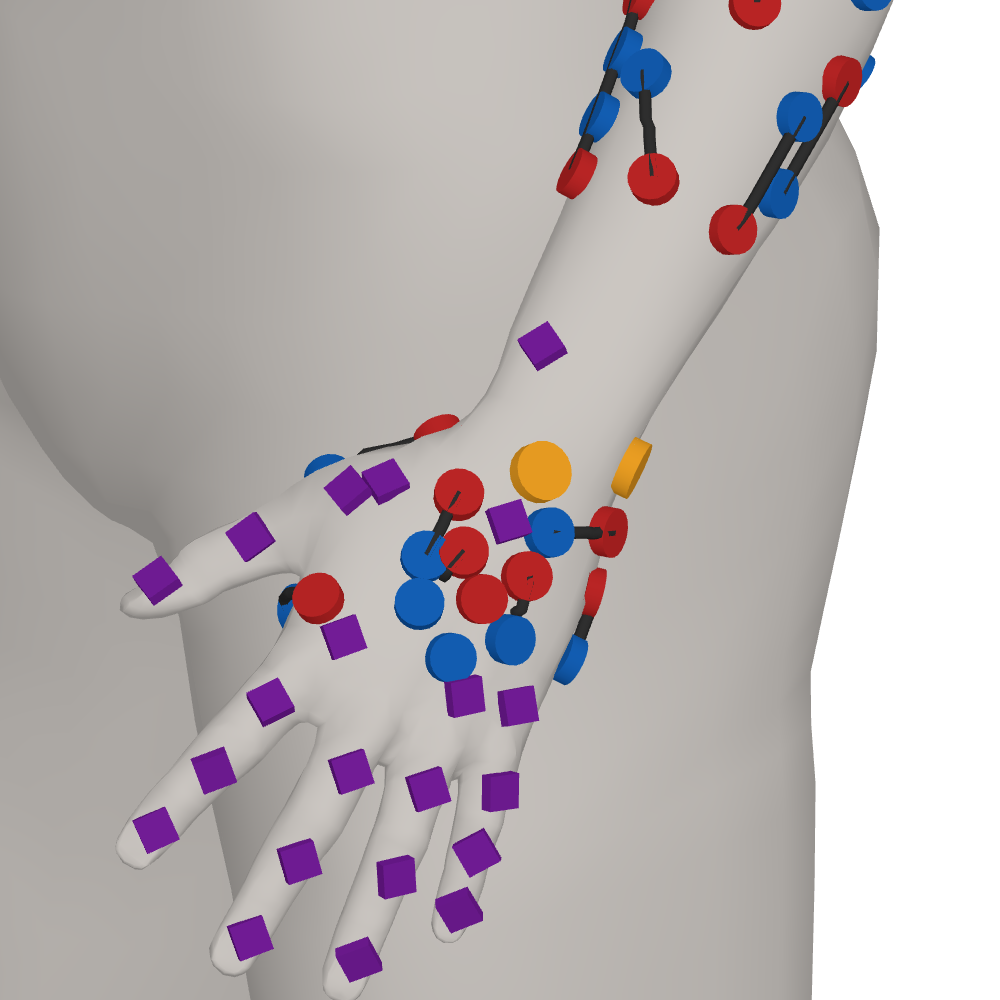
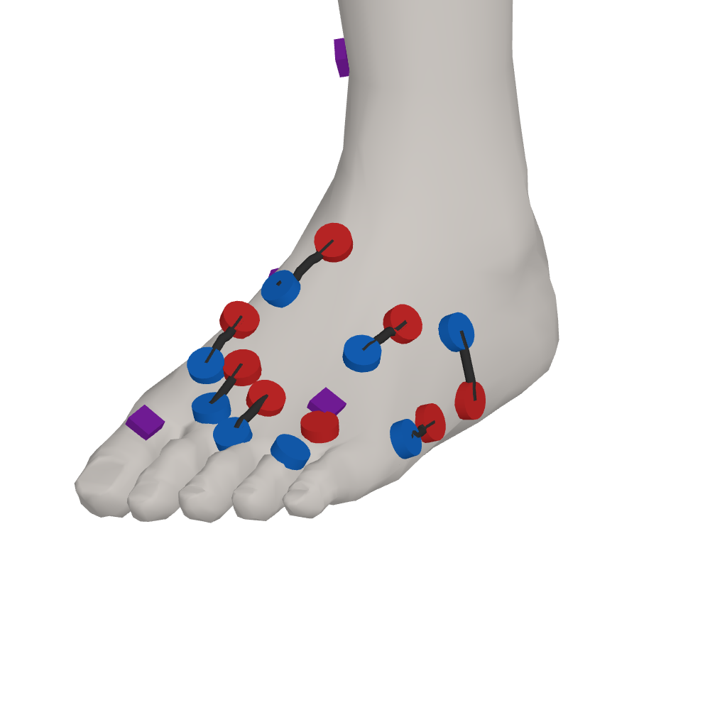
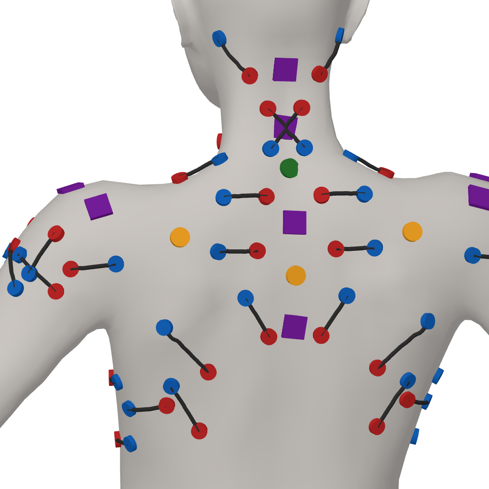

# Bogatyr

**The meat on Kaščej's bones:** where every electrode and every IMU sits on the body, and why.

↑ [NIC-Crazy_Ivan](../README.md)

---

*Bogatyr*, the strongman of the Russian byliny. Kaščej, the harness, is bone and skin (see
[Rubaška](../rubaska/CONSTRUCTION.md#harness-and-washing)); dressed in the electrodes on the
muscles and the IMUs on the bones, he is a bogatyr.

**A proposal, not yet tried on a body.** Every channel is laid out by the main muscle groups, from
several studies and anatomy books, named where a place has one; the first recordings check it, the
first arm first, before a strip is drawn in a series. Where a place is an estimate, it says so.

## What it lays out

- **The EMG of 16 modules,** every chip an ADS1298: fourteen of the body with two, 32 electrodes and
  a bias electrode each, measuring differentially, a channel P against N; the head's with two, 32
  electrodes, a bias and one reference electrode, the neck's with one and 16, both ways there,
  against the reference the P against one point, which the strip wires to the channels' negative
  inputs (see [Rubaška](../rubaska/HARDWARE.md#right-leg-drive)): 514 electrodes on the modules, and
  the hand's and the foot's sixteen with a bias on the glove's and the sock's own ADS1298, 582 in
  all. A channel's two electrodes lie 4–8 cm apart where the muscle allows, 2–3 cm on small muscles
  and near the heart, along the fibres and across them by turns, and across the spine only
  diagonally. **All 280 channels are laid out:** a module's first eight on its area's main muscles,
  one site each, its second eight on the same muscles' other parts, a second ring on a limb or
  crossed to a neighbour; the hand's and the foot's eight on their edges and backs (see
  [construction](CONSTRUCTION.md#the-modules)).
- **The IMUs,** 44 on the body of 64 places, two or more on each segment of a limb, more where
  the skin slides most, four in a square on the head and four down the neck and the upper back;
  the gloves' 2 × 20 and the socks' 2 × 8, 100 in all.
- **What was left out,** the muscles surface EMG cannot reach and the places the body presses
  on, and the layouts before this one.

## On an average body

**The whole layout,** drawn to see it whole, an estimate on an average body (see
[construction](CONSTRUCTION.md#open-questions)).

Every place of [construction](CONSTRUCTION.md) put on MakeHuman's average body by the bones'
landmarks: P red, N blue, each channel a line between them, the two references green, the bias
yellow, the IMUs violet. The landmarks are estimates on that body, not measured (see
[software/body](../software/body/README.md)); the modules are not drawn, their places on the
trunk not being set. Up close, each with its own modules alone:

| the head | the hand and the forearm | the foot and the calf | the neck, the upper back and the shoulders |
|---|---|---|---|
|  |  |  |  |

The glove is drawn with its 20 IMU places, the sock with its four to start (see
[construction](CONSTRUCTION.md#the-imus)).

| file | what is in it |
|---|---|
| [CONSTRUCTION.md](CONSTRUCTION.md) | the electrodes' rules; the modules one by one, every muscle with its P and N, the reference and the bias; the IMUs' rules and places; the glove's |
| [WHY.md](WHY.md) | what was left out, and why; the layouts before this one |
| `body.png`, `head.png`, `hand.png`, `foot.png`, `neck.png` | the layout on an average body, an estimate, drawn by [software/body](../software/body/README.md) |

What the electrodes, the strips and the harness are made of is under
[Rubaška](../rubaska/CONSTRUCTION.md); the modules and the glove under
[Rubaška's hardware](../rubaska/HARDWARE.md).

## Scale

| | modules | electrodes | IMUs |
|---|---|---|---|
| the body | 16: the head, the neck with the upper back, the two shoulders, the chest with the abdomen, the lower back, the two hips, and two on each limb | 496, 32 on a module of the body and on the head's, 16 on the neck's; a bias electrode on every module and a reference on the head's and the neck's, 514 | 44 of 64 places |
| the gloves | one unit each, the hand's: an ADS1298 on the board | 2 × 17: sixteen and a bias | 2 × 20 |
| the socks | one each, the foot's | 2 × 17 | 2 × 8 |
