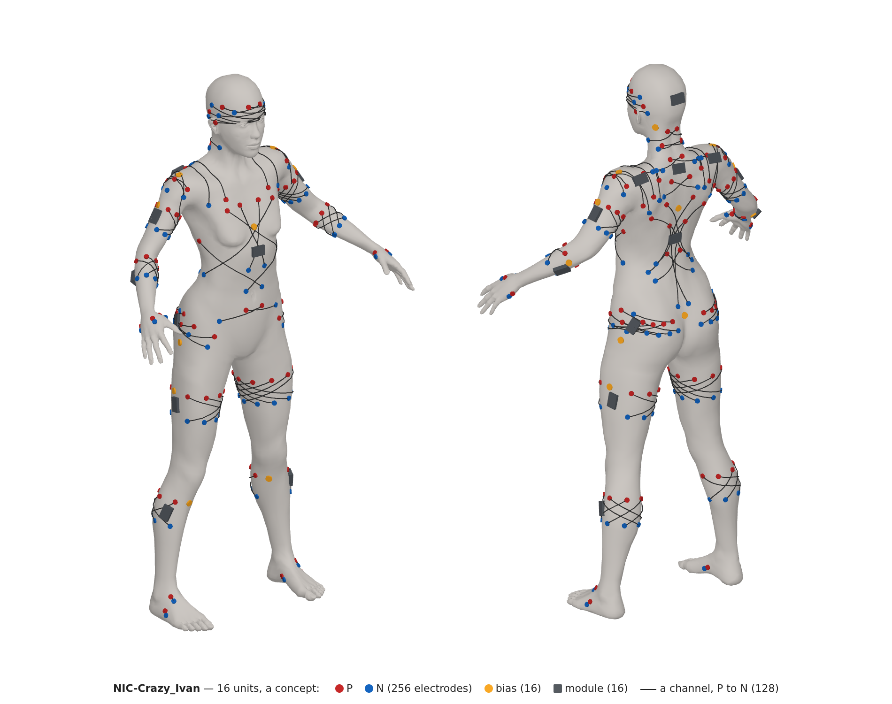

# Rubaška: construction

**The electrodes and their leads,** the fabric, the harness and the washing, where the IMUs sit,
and the glove and the foot on the body.

↑ [Rubaška](README.md) · [NIC-Crazy_Ivan](../README.md)

---

## Electrodes

The electrodes are not tied to one common point. Within each block, the electrodes of
different channels cross one another, so every channel measures a mix of signals. The
[project README](../README.md#tomography) explains why.

*A concept: the 16 units on an average body, front left and back right, the 256 electrodes (P
red, N blue), the 128 channels as lines from a P to an N, the 16 bias electrodes (yellow) and the
16 modules (grey), drawn by [software/body](../software/body/README.md). The places are this
page's rules applied to an average body, not measured; a channel is drawn over the skin, though
it sees through the tissue.*

| part of the body | units | electrodes | channels |
|---|---|---|---|
| head | 1 | 16 | 8 |
| neck and upper back | 1 | 16 | 8 |
| shoulders | 2 | 32 | 16 |
| chest and abdomen | 1 | 16 | 8 |
| lower back | 1 | 16 | 8 |
| hips | 2 | 32 | 16 |
| upper arms | 2 | 32 | 16 |
| forearms and hands | 2 | 20 + 12 | 16 |
| thighs | 2 | 32 | 16 |
| calves and feet | 2 | 20 + 12 | 16 |
| **the suit** | **16** | **256, and 16 bias** | **128** |

**Whether it works, we do not know.** The crossing is not how surface EMG is usually taken:
SENIAM puts a pair 20 mm apart along a muscle's fibres. What is known points our way without
proving it: wider pairs, 4 cm against 2 cm, recognised movements better, and channels both along
and across the fibres held up better when the electrodes shifted, four to six channels sufficing
for a forearm (Young, Hargrove and Kuiken, *Improving myoelectric pattern recognition robustness
to electrode shift by changing interelectrode distance and electrode configuration*, IEEE TBME
59, 2012). By that such a layout might work; one arm, against neighbouring pairs, decides.

Every module has its sixteen electrodes and a bias electrode, best over bone or tendon near its
electrodes, and room for a reference electrode, which the suit does not fit (see
[Right-leg drive](HARDWARE.md#right-leg-drive)): the unit is the same for the suit and for
anything else, a headband for the brain's signals or a trial. A suit of 16 modules has 256 + 16.
One bias electrode drives the body and the others wait as spares.

**A limb's two rings.** A limb's unit is two rings 6–8 cm apart along it: the P on the first,
the N on the second, eight and eight on the upper arm and the thigh, five and five on the forearm
and the calf. Each P goes to the N half a turn round, so every channel runs obliquely through the
limb, along the fibres and across them at once, and measures a mix of the muscles it passes: a
"tomography" in quotes, not every electrode against every other, which no eight channels could
give, but each channel a different path through the muscles. It is the main way. Against a
reference, the second way on the same board when a reference electrode is fitted, the eight P
measure each against it and any pair of them can be formed in software as the difference of two
channels. How far round the N should lie is to be scored like the single ring below.

For a single ring of sixteen, the first layout, `software/bands/chords.py` scored every pairing of
the P with the N electrodes, 8! = 40,320,
on 200 random cross-sections of a model limb: a homogeneous disk with an insulating skin, seven
superficial muscles and four deep ones as line sources. A sketch, not anatomy; it shows which
way a choice leans.

| pairing | muscles told apart (cond) | the deep ones' share | change when the band sits ~1 cm round |
|---|---|---|---|
| neighbours, P beside N | 0.015, the best | 0.36 | 47%, the worst |
| every chord three places | 0.008 | 0.41 | 31% |
| every chord across the limb | 0.007 | 0.47, the most | 23%, the least of all 40,320 |
| against the reference | 0.005 | 0.45 | 27% |

- **Neighbours tell the muscles apart best,** but only while the band sits exactly where it
  sat; moved by a centimetre, their channels change by half.
- **Chords across the limb** lose half of that: the weakest mix of muscles stands ~6 dB less
  above the noise, which EMG, tens of decibels above the ADS1299's 1 µVpp (SBAS499C), can
  likely spare (an estimate). They take a moved band twice as well and see deeper. A model
  learns from one wearing and works on the next, so the crossing goes with the
  [tomography](../README.md#tomography): it trades a little resolution, in the margin above
  the noise, for a model that does not have to learn the wearer again each time.
- **Neighbours stay as the harness to compare,** on one arm, with the same electronics: only
  the wiring of the band differs. The arm decides how much a model loses after the suit comes
  off and goes on again.

**Where the modules sit,** a first layout to start from, sixteen for sixteen modules: eight on the
limbs, two a limb, each a band round its segment, and eight on the torso, each an area with its
sixteen electrodes spread over its muscles, the chords crossing them. Each lies over the muscles'
bellies, not near a joint, where mostly tendons run, and carries its own module. The places are
checked against SENIAM's sensor locations (seniam.org, 27 muscles, each with its spot on a line
between two landmarks and 20 mm between the electrodes); SENIAM gives none for the forearm, the
abdomen's front, the chest's front, the neck or the head, which are checked against Gray's *Anatomy
of the Human Body* (1918, the myology chapter).

| segment | bands | where | the muscles under it | checked against |
|---|---|---|---|---|
| upper arm | 1 a side | two rings of eight round the middle of the line from the acromion to the olecranon, at its 35% and 65% | the triceps' long and lateral heads at their spots, the biceps a sixth above its spot, the brachialis | SENIAM: triceps at 50%, biceps at 1/3 from the elbow |
| forearm and hand | 1 a side | two rings of five in the upper half, from ~5 cm below the elbow; six on the hand across the wrist, three pairs: on the back between the thumb and the index, at the thumb's edge from its root, at the little finger's edge | the flexors and extensors of the wrist and fingers, the brachioradialis; the first dorsal interosseous, larger than the other three (Gray's, the Interossei), the thenar and the hypothenar from their edges | Mogk and Keir (2003), seven pairs round the proximal forearm; iWorx's lab sheet, flexors ~8 cm and extensors ~9 cm below the elbow; Gray's: the flexor carpi radialis' tendon is more than the lower half of its length, the brachioradialis' fibres end above the middle, the extensor carpi radialis brevis' about the middle, the longus' at the upper third |
| thigh | 1 a side | two rings of eight round the middle of the line from the anterior superior iliac spine to the patella, ~7 cm apart | the rectus femoris, the biceps femoris and the semitendinosus at their spots, the vastus lateralis a sixth above its, the adductors | SENIAM: rectus femoris, biceps femoris, semitendinosus at 50%; vastus lateralis at 2/3, vastus medialis at 80% |
| calf and foot | 1 a side | two rings of five in the upper half, below the knee; six on the foot across the ankle, three pairs: the instep, the inner edge, the outer edge | both heads of the gastrocnemius, the tibialis anterior and the peroneus longus at their spots; the extensor digitorum brevis, a broad thin muscle on the back of the foot, the abductor hallucis along its inner border, the abductor digiti quinti along its outer border (Gray's) | SENIAM: gastrocnemius lateralis and tibialis anterior at 1/3, the medialis on its bulge, peroneus longus at 25% from the fibula's head |
| hip | 1 a side | the side of the hip and the upper buttock, between the iliac crest and the greater trochanter, from the front to the back | the gluteus medius, the tensor fasciae latae in front, the gluteus maximus' upper part behind, above where one sits | SENIAM: gluteus medius at 50% on the line from the iliac crest to the trochanter |
| neck and upper back | 1 | round the neck up to the skull, and down the back between the shoulder blades | the sternocleidomastoid, the splenius and the semispinalis, the levator scapulae, the upper trapezius, the upper erectors | SENIAM: upper trapezius at 50% from the acromion to C7; Gray's for the neck |
| shoulder | 1 a side | the shoulder cap, the shoulder blade and the upper chest beside it | the deltoid's three parts, the middle trapezius, the supraspinatus and the infraspinatus, the pectoralis' clavicular part | studies after SENIAM: the deltoid's middle halfway from the acromion to the deltoid tuberosity, the posterior two finger widths behind the acromion's angle; the anterior one finger width below and in front of the acromion or 6 cm below it, the sources differ; SENIAM: trapezius middle at T3 |
| chest and abdomen | 1 | the front of the torso from the collarbones to the groin's fold | the pectoralis' sternal part, the serratus anterior, the rectus abdominis, the external and internal obliques | Gray's; SENIAM gives no spots for the front |
| lower back | 1 | the back from the shoulder blades' lower angles to the sacrum | the latissimus dorsi, the thoracic and lumbar erectors, the multifidus | SENIAM: longissimus beside L1, iliocostalis at L2, multifidus at L5, lower trapezius at 2/3 towards T8 |
| head | 1 | a headband round the forehead, the temples and above the ears; the 16 on the front half, from ear to ear | the frontalis; the temporalis' front part, which closes the jaw | Gray's: the frontalis has no bony attachment, the temporalis fills the temporal fossa, the occipitalis lies on the superior nuchal line with only the galea between the two; Castroflorio et al. (2005): the anterior temporalis |

- **The forearm and the calf** each take two rings of five, five crossed channels, and three pairs
  beyond the joint: the hand across the wrist, the foot across the ankle. The hand has no module
  of its own: the Vnučata leave no room on its back. Each pair beyond the joint is on its own
  muscle, not crossed. The foot keeps off the sole, which is stood on.
- **The hand** keeps off the palm: a grip presses there, the electrodes would wander, and it
  would show in the signal. On the back only the first dorsal interosseous is taken; the other
  three are thin and lie under the extensors' tendons. The glove is tight, elastic in the
  middle, its seams sitting in the spaces between the fingers so that it hardly moves.
- **The hip** takes the side, not the seat: the gluteus maximus' lower part is sat on, and so
  pressed like the palm.
- **The neck sits loose and keeps off the carotid's division.** The common carotid divides opposite
  the upper border of the thyroid cartilage, where it lies comparatively superficially (Gray's, the
  carotid triangle); pressure on the carotid sinus there can slow the heart to a faint in people
  whose sinus is oversensitive, and a tight collar is a known trigger (StatPearls, carotid sinus
  hypersensitivity). Nothing presses there; the neck's fabric is no tighter than a shirt's collar.
  Behind, between C6 and T3, the trapezius is tendinous at the midline (Gray's).
- **The headband's back half carries no electrodes:** it lies in the hair, over the occipitalis at
  the sides and only the galea between them, and it carries Nataša's board (see
  [Nataša](../natasa/CONSTRUCTION.md#on-the-head)): one headband for both, laid out there round
  the glasses' temples. The front half is the
  forehead and the temples, mostly free of hair; the electrodes above the ears sit in it, their
  contact to be tried. Like a half of a ring of 32, its chords cross the front half.
- **The head and the neck are one piece,** like a turtleneck: the headband above, the neck's unit
  below, fabric between them over the back of the head and behind the ears. The face, the
  chin and the front of the neck stay free. The fabric holds the band and the neck's unit in place
  without a strap; hair cut short, ~3 mm, helps the electrodes above the ears, to be tried.
- **The torso's eight are areas, not rings:** the head, the neck with the upper back, the two
  shoulders, the chest with the abdomen, the lower back and the two hips. Within each the
  chords cross the area's muscles in patterns of their own, which are laid out unit by unit;
  rings would have taken one height only.
- **Left out on purpose:** the wrist and the ankle, mostly tendons; the sole's muscles, stood on;
  the gluteus maximus' lower part, which is sat on; the soleus and the peroneus brevis, whose spots
  lie in the lower calf; the thumb's and the index finger's long muscles (the abductor pollicis
  longus, the extensores pollicis and indicis, the flexor pollicis longus), which arise from the
  middle third of the forearm's bones and lie deep (Gray's), the thumb showing in the hand's pairs
  and the IMUs; the masseter and the muscles that open the jaw, out of a headband's reach.
- **The bias electrode,** one a unit, and the reference where one is fitted, go over bone or
  tendon, as SENIAM puts its own reference over bone (C7's spinous process, the wrist, the
  ankle): the torso's in the table below, the bias first; the limbs' beside the gap.

**The units in detail.** Each torso unit's sixteen are laid out by its muscles, eight places on
each of its two halves: left and right, or, on a shoulder and a hip, front and back. On each half
P and N alternate from place to place, so that against the reference the eight P still cover
both halves; each channel is a chord from a P on one half to an N on the other at another
height, so that the chords cross and each runs through two muscles that act together or against
each other. Gray's (1918, the Actions of each muscle) gives the pairs: one sternocleidomastoid
turns the face to the other side, aided by the splenius of the other side; the deltoid's front
fibres with the pectoralis draw the arm forward, its back fibres with the teres major and the
latissimus backward; the infraspinatus and the teres minor turn it out, the pectoralis in; the
abdominal muscles of one side bend the trunk to that side and turn it to the other; the erectors
of one side draw the chest to their side; the gluteus medius' front fibres and the tensor
fasciae latae turn the thigh in, the maximus extends it. A first layout, to be tried on a body.

| unit | the eight places of a half | the other half | bias; a reference, if fitted |
|---|---|---|---|
| neck and upper back | the left: ~3 cm beside the spine below the skull (C2), at mid-neck (C4–5), at C7–T1 and at T4; the sternocleidomastoid at mid-height, from the side; the levator scapulae behind it; the upper trapezius (SENIAM: 50% from the acromion to C7); the rhomboid between the shoulder blade and the spine at T5 | the right, mirrored | C7's spinous process; T6's |
| shoulder, each side | the front and the top: the pectoralis' clavicular part below the collarbone's middle; the pectoralis beside the groove to the deltoid; the deltoid's front part, upper and lower; its middle part, upper and lower (halfway from the acromion to the deltoid tuberosity); the supraspinatus above the scapula's spine, outer and inner | the back: the deltoid's back part, upper (two finger widths behind the acromion's angle) and lower; the infraspinatus at the scapula's outer border and in its middle; the teres minor along the outer border; the teres major at the lower angle; the middle trapezius at T3 between the scapula and the spine (SENIAM) and at the root of the scapula's spine | the acromion; the scapula's spine near the spine |
| chest and abdomen | the left: the pectoralis' sternal part, inner and outer, above the breast; the serratus anterior on the side at the sixth rib; the rectus abdominis above, at and below the navel; the external oblique below the ribs at the side; the internal oblique above the groin's fold, by the iliac spine | the right, mirrored | the sternum's upper part; its lower part |
| lower back | the left: the latissimus below the shoulder blade's lower angle and above the iliac crest; the lower trapezius (SENIAM: at 2/3 from the scapula's spine towards T8); the thoracic erectors at T10; the longissimus beside L1 and the iliocostalis at L2 (SENIAM); beside the erectors at L3, over the quadratus lumborum; the multifidus at L5 (SENIAM) | the right, mirrored | the sacrum's middle crest; T10's spinous process |
| hip, each side | the front and the side: the tensor fasciae latae below and behind the front iliac spine, two; the gluteus medius' front fibres, two; its middle (SENIAM: 50% from the iliac crest to the trochanter), two; just below the iliac crest, two | the back: the gluteus medius' back fibres, two; the gluteus maximus' upper part, above where one sits, six, the lowest on SENIAM's line from the sacrum to the trochanter at most | the greater trochanter; the iliac crest |
| head | the left of the headband: over the forehead (the frontalis), two; at the temple, the temporalis' front, three; above the ear, the temporalis, three | the right, mirrored | behind the ears, over the mastoids |

What the chords join, by the pairs above: across the spine on the neck, a turn of the head;
over the shoulder, the front deltoid with the back one, the pectoralis with the infraspinatus,
the middle deltoid with the teres major, the supraspinatus with the middle trapezius; across the
midline in front and behind, a bend and a turn of the trunk; over the hip, the tensor and the
front medius with the maximus; on the head, the brow and the jaw's closing on both sides.

The limbs keep their two rings (above), each P to the N half a turn round on the other ring, and
the three pairs on the hand or the foot, each on its own muscle. On a woman the chest's
pectoralis spots sit above the breast; the sixth rib's serratus beside it.

**The heart and the breath.** The heart's ECG shows in the EMG, strongest on the torso and
weaker on the limbs. Cleaning the EMG means estimating the ECG and subtracting it, and the ECG
so removed gives the heart rate and its rhythm for free. Breathing shows the same way, in the
diaphragm and the lower abdominal muscles. What has to be compensated anyway, because it
disturbs the signals we want, is kept once it is separated.

**Material.** The electrodes are stainless-steel studs, kept moist.

- The grade is **316L**, the steel of body jewellery. 316Ti is not needed: its titanium protects
  the steel at high temperatures (welding), not on the skin.
- A cheap source is marine press studs in 316 (A4), made for boat covers and sold in kits with a
  hand tool for pressing them into fabric; the polished cap is the electrode. Cheap "stainless"
  studs are often 304 or plated brass, so the grade has to be 316/A4.
- Stainless steel has more low-frequency noise and drift than Ag/AgCl, which is acceptable for
  EMG. The ADS1299's input itself would cope even with dry contacts (datasheet SBAS499C):
  1000 MΩ input impedance and ±300 pA bias current, so a 1 MΩ contact shifts the input by
  0.3 mV, and the input range is ±VREF / gain, ±375 mV at our gain of 12. The input filter
  would not: with 1 MΩ contacts its corner falls to ~360 Hz, inside the band.
- **Moist, not dry.** A ring around each electrode holds the skin's moisture under it, so the
  contact sits far below the ~1 MΩ of a dry one; tens of kilohms are taken as the working
  figure, to be measured. The ring is of dissipative material, not plain plastic, which would
  charge by friction. Moisture also lets charge from friction decay faster.
- **8 mm studs where there is room, 6 mm on the forearm and the hand,** each in a ring at least
  5 mm wide. The ring keeps even a small stud moist, but its contact and its noise still grow as
  it shrinks (see [The noise](HARDWARE.md#the-noise)). A band's sixteen sit a sixteenth of the
  girth apart: ~16 mm on the forearm takes a 6 mm stud with 5 mm of ring each side; ~19 mm on the
  upper arm, ~23 mm on the calf and ~34 mm on the thigh take 8 mm. The girths are our estimate,
  and the hand, the tightest, finds its rings' width on the body.
- 316L contains nickel; anyone allergic to nickel tries it on the skin first.

**The offset.** Two metal electrodes on the skin differ by a DC voltage that adds to the channel
and wanders. Steel polarises; Ag/AgCl hardly does, which makes it the reference electrode of the
field.

- Wet Ag/AgCl ECG electrodes: a median offset of 0.5–4 mV (*The electrical characteristics of
  some commercial ECG electrodes*, PubMed 621452).
- Dry metal electrodes in the ear: a spread of 46 mV, from −108 to +176 mV over 122 measurements
  (*Dry Electrodes for Human Bioelectrical Signal Monitoring*, Sensors 2020, PMC7374322).
- Stainless steel on the skin: no figure found.
- ECG amplifiers are commonly required to work with ±300 mV of offset (IEC 60601-2-25, read only
  second hand, not in the standard itself).
- Titanium films on steel come close to Ag/AgCl in the quality of surface EMG (Rodrigues et al.,
  Materials 2020, PMC7254203; Ti–Au films, Sensors 2021, 21, 8143); their offset was not
  measured. Titanium is covered by its oxide and so polarises like steel; that is our inference.
- The gain is 12 for this, ±375 mV (see [Software](SOFTWARE.md#the-ads1299s-settings)).
- The offset needs no instrument: the ADS1299's input is DC-coupled (SBAS499C, 10.1), so the
  mean of a raw channel is the offset, and a few minutes recorded on Baťa show its drift.

**The price** of other electrodes, as listed in October 2026, for 288 of them:

| electrode | apiece | for 288 | where listed |
|---|---|---|---|
| sintered Ag/AgCl | $7–13 from 500 pieces; $8–12 with a lead, from 100 | ~$2,000–3,700 | Greentek (Wuhan), its Alibaba store |
| sintered Ag/AgCl, 12 mm | €0.17–0.21 from 5,000 pieces | the least order ~€850–1,050 | Alibaba |
| sintered Ag/AgCl cups, single use | $19.95 for 24 | ~$240 a set | Compumedics (Neuromedical Supplies) |
| sintered Ag/AgCl DC-EEG disc | $37.95 | ~$10,900 | bio-medical.com |
| titanium press studs | not sold off the shelf; made to order | — | — |

The cheap Ag/AgCl pieces are EEG discs and cups, not press studs: how they would sit in the
fabric is not known. A sintered electrode is Ag/AgCl right through and is renewed by rubbing its
face; the makers tie its DC stability to a chloride gel, and how it fares on sweat alone was not
found.

**The band's strip.** The electrodes do not hang on wires: each band is a flexible printed
circuit, polyimide, two layers, made by JLCPCB, that carries the studs and runs to the module.

- **A piece of a cone's mantle.** A flat flexible circuit can be bent to a cylinder or a cone,
  but not to a sphere or an irregular surface (Vanfleteren et al., *Printed circuit board
  technology inspired stretchable circuits*, MRS Bulletin 37, 2012). A limb under its band is
  near a cone, so the strip is cut as a sector of a ring, the cone unrolled: its angle is the
  difference of the girths at its two edges over its width, its outer radius the larger girth
  over that angle. On the forearm a few millimetres of difference over ~15 mm of width give a
  radius of about a metre, by our estimate of the girths; the strip then lies on the limb
  without wrinkling or pulling sideways.
- **It does not stretch.** It only wraps round the body, a static bend, which polyimide bears
  well; a band of it closes with a stretch of elastic fabric, which takes the wearer's size and
  the swell of a working muscle: after contractions an arm measured 0.4–1.0 cm more (Journal of
  Sports Science and Medicine 2008, 7, table 2). Two or three lengths of strip for each band.
- **The limbs' rings stretch:** a working biceps or calf swells more than a fixed ring takes,
  and the forearm's and the calf's cross the wrist and the ankle, so all eight limb units are
  the glove's stretchable circuit, copper on TPU, two layers for the ground (Würth's
  STRETCH.flex is made single- and double-sided), one piece each into the module's one connector,
  with a small elastic gap: over the ulna's edge on the forearm, over the tibia on the calf, on
  the outer side of the upper arm and over the iliotibial tract on the thigh, so that the inner
  side carries electrodes too; by anatomy, to be checked against the atlas. The module sits on
  the outer side, where nothing rubs it. The torso's areas, over the shoulder above all, which
  turns in three axes, take what their layout asks for, polyimide where the skin does not
  stretch, TPU where it does.
- **The pads** at a fixed pitch, the bias electrode beside the gap, a reference pad only where
  one is fitted; no trace runs further than half the girth: ~12 cm on the forearm, ~27 cm on the
  thigh. The strip ends in a stiffened
  tail in the module's locking flexible-circuit connector (see
  [hardware](HARDWARE.md#sensing-module)); JLCPCB makes flexible circuits up to 234 × 490 mm in
  regular orders, with stiffeners of polyimide, FR4 or steel (JLCPCB, *Flex PCB capabilities*).
- **The second layer is ground,** the shield, hatched by our choice so that the strip stays
  supple, or JLCPCB's shielding film of 18 µm. A channel's P and N cannot run side by side all
  the way, as they sit across the limb from each other; they run under the same ground.
- **Less charge from friction.** In a cable the charge is made where the insulation rubs the
  shield as it bends (US patent 6,232,789); the low-noise cables put a graphite layer there
  (PCB Piezotronics, *WPL 43, Accelerometer Signals*). In a printed circuit the layers are bonded
  and do not rub, so it should make less; that is our inference, and no source gives the charge
  in figures (makers of cables state only ratios, such as ~1,000 times less than RG58, FEMTO,
  CAB-LN1), so it is measured on a sample.
- **The moist contact eases the rest.** Charge from friction is a small current, and the
  voltage it makes is that current times the contact; at tens of kilohms instead of a megohm
  it is ten to twenty times smaller, and so is the mains that unequal contacts turn into a
  difference.
- The strip is sewn into the band under the dissipative layer, so that nothing rubs it.

**The stud on the strip.** The stud is pressed through the strip at its pad and holds it by
pressure; a rivet through a flexible circuit's pads, held by its clamping force, is used in
wearables (a wearable neurostimulator, US patent application 2024/0039190).

- The pad is gold (ENIG), stiffened under the stud, so that the press does not tear the
  polyimide.
- A soft disc spring under the stud keeps the pressure as the materials move with heat.
- A non-curing, elastic sealant on the pad before the press: the press squeezes it out, the
  metals meet directly, and the sealant round them shuts out sweat and water. Gold against
  steel in sweat would make a cell; sealed, it stays dry and the strip can be washed. Which
  sealant, and how many washes it bears, the sample shows.

**Fabric.** The base is cotton, no synthetics or plastic; cotton sits near the middle of the
triboelectric series, synthetics at its ends.

- A conductive suit would short the electrodes or carry crosstalk between them. A
  **static-dissipative** fabric is used instead. ANSI/ESD S541 calls a material conductive
  below 10⁴ Ω, dissipative from 10⁴ to below 10¹¹ Ω and insulative above. A dissipative layer
  drains the charge slowly without shorting the signals.
- **From the top of that range,** gigaohms between neighbouring electrodes. It may then lie on
  the skin and touch the electrodes: against even a dry 1 MΩ contact, 1 GΩ makes ~0.1% of
  crosstalk, and against a moist one far less.
- **No wire:** the charge from friction drains through the fabric into the skin, and the body
  is held by the right-leg drive; currents of nanoamperes do not trouble it.
- Carbon, not silver: silver is too expensive, and fabric with a grid of carbon fibres is sold
  for antistatic workwear.

## Harness and washing

The electrodes, the leads and the line cables ride on a simple strap harness worn under the
clothes. The harness is rinsed in clean water; the clothes go into the washing machine. Taking
the cables off and putting them back for every wash would wear them out sooner than wearing the
suit does.

- The units unplug before rinsing. Rinsing washes the sweat salt off the IDC contacts; they then
  dry thoroughly.
- The cable bundles lie in the straps along the main axes of bending. That has to be drawn,
  tried and sewn as a prototype.
- The units sit in 3D-printed enclosures, each with a red star.
- **The harness is cut from an overall.** A whole close-fitting overall, gloves included, is
  sewn, the bands' places are marked on the wearer, and the rest is cut away: the bands stay,
  joined by strips of fabric. The strips hold the bands to one another, so a band shifts and
  turns less than one on its own, the shift the crossing of the chords was chosen against.
  Nothing is left over the groin or the larynx. A bought compression overall serves as the
  pattern only, being synthetic; the harness is of the suit's cotton with some stretch.
- **It zips at the back,** with a long cord on the zip's pull, as on a wetsuit, so the wearer
  closes it alone.

The cable and its connectors are described under
[Porjadok](../porjadok/HARDWARE.md#cable-and-connectors-in-the-suit).

## IMU placement

Up to 64 IMUs go on the suit, one on every body segment and more where a segment twists: two on
each long bone, one near each end. The glove's and the foot's come on top, below.

- Each IMU measures the orientation of its own segment. Sensor fusion keeps it as a quaternion,
  which has no singularity, and a joint's rotation is the difference between two neighbouring
  IMUs, again a quaternion. A singularity can only appear when a result is turned into three
  angles at the output; see [Porjadok](../porjadok/SOFTWARE.md#output).
- **No magnetometer.** Indoors the steel in a building bends the Earth's field, differently from
  place to place, so no calibration takes it out. Gravity shows an IMU's tilt but not its turn about
  the vertical, and the gyro alone drifts in that. Across a joint the turn is pinned anyway: both
  bones share the joint's centre, and an IMU off the joint's axis runs round a circle, so the
  centre's acceleration worked out from the IMU on either side must agree. Every movement corrects
  the drift. Standing still, a gyro reads nothing but its own offset, which is measured and taken
  off; silent EMG confirms the stillness, since a slow movement that the accelerometers barely see
  still shows in the muscles. With an IMU near each end of every long bone, every joint has one
  close by on each side. Seel, Schauer and Raisch find a joint's axis and centre from such
  constraints (IEEE CCA 2012); Weygers et al. remove the drift using only what the IMUs on two
  connected segments measure in common, and put knee angles 2–4° RMS over 7 minutes of walking (IEEE
  Sensors Journal, 2020; both from the abstracts). What stays unseen is which way the whole body
  faces in the room, and joint angles do not need it.
- Twist shows as a gradient along the segment. Turning the palm over is the radius rolling
  round the ulna: the forearm IMU by the wrist turns through almost the whole range, the one by
  the elbow a little, the one on the shoulder hardly at all.
- Skin slides over bone, so an IMU on the skin does not turn exactly with the bone. It is worst
  for the upper arm turning round its own axis, where the muscle moves under the sensor.
  Several IMUs per bone and the EMG of the muscles doing the turning give the model enough to
  tell the two apart.
- The suit never sits the same way twice, for the IMUs as for the electrodes. A calibration
  pose at the start, a few seconds standing with the arms down or out to the sides, gives the
  model its starting point. IMU motion-capture suits do the same.

## The glove and the foot

- **The glove's board** sits on the back of the hand, with the five Vnučata and the IMU behind
  the wrist (see [hardware](HARDWARE.md#the-glove-and-the-foot)). Its 18 to 20 IMUs: three on
  each finger, the thumb's two phalanges and its metacarpal, the ring finger's and the little
  finger's metacarpals mid-bone, and a second on the thumb where its skin slides. The palm's
  arch bends only past the middle finger: the index's and the middle finger's metacarpals
  hardly move against the wrist, the ring finger's and the little finger's do (anatomy, not
  measured here).
- **Over bone,** not between the bones, where the interosseous muscles bulge under the skin.
- **The wiring is a stretchable printed circuit,** copper on TPU with meanders, laminated into
  the glove's inner layer: 5–20% of repeated stretch by its layout, turned round and round
  without harm, gentle on the skin, softening at 155–185 °C, soldered with SnBi; samples on
  request (Würth Elektronik, *STRETCH.flex*, webinar 2021; Murata makes the like). It runs along
  the sides of the fingers, never across their backs, where the skin stretches least. Each
  branch ends in a tail stiffened over ~4 mm and goes into its IMU board's five-way locking
  connector: SCL, SDA, +3.3 V, ground and CLKIN (see [the IMU board](HARDWARE.md#the-imu-board)).
  Up to ~10 cm a finger, ~6 cm to its last phalanx.
- **One spider or five noodles,** whichever proves cheaper and lasts better and is easier to
  mend: one circuit for the whole hand, a leg a finger, into one larger connector on the
  glove's board; or five strips, one a finger, each into a small connector of its own. The
  spider is one part and one connector; a noodle is a simple shape, and a torn one is replaced
  alone.
- **A glove of two layers** with a hook-and-loop closure: the outer one comes off, the inner one
  with the circuit is pulled out and a new one goes in.
- **The fallback** is five PTFE wires of 28 AWG along the sides of the fingers, as the IMU board
  was first drawn, should the stretchable circuit fail on a sample.
- **Across the wrist** go five wires: TX, RX, the suit clock, +4 V and ground.
- **The foot** has three or four IMUs below the calf's module: the heel, the instep and the toes,
  and a fourth where it is wanted, on one Vnučka on the instep, with the same five wires to the
  calf's module; its IMUs on one noodle like a finger's.

## Open questions

- the band's strip on a sample: bent, tapped and rubbed while recording, its fit on the limb as a
  piece of a cone, the elastic gap over the bone, and the girths that set two or three lengths,
- the stud on the strip: the disc spring, the sealant, washed again and again; the contact
  through it and the offset, against a stud on a wire,
- the ring around the electrode: its dissipative material and shape, and the contact it gives,
  measured,
- the electrodes on a sample: 316/A4 marine press studs, titanium and sintered Ag/AgCl side by
  side on one arm: the contact, the noise, the skin, and the offset with its drift; Ag/AgCl goes
  in only if the steel drifts too far,
- the girths under each band, and the studs' and rings' sizes they allow,
- the torso's units laid out on a body, and the backpack's straps over the shoulders' units:
  they must run beside the electrodes or be padded,
- the limbs' two rings scored by `software/bands/chords.py` like the single ring of sixteen: how far
  round the N should lie, and how far apart the rings; the deltoid's anterior spot, where the
  sources differ; the hip's arc tried sitting and walking,
- a prototype of the harness, cut from an overall; how much stretch the cotton may carry,
- the glove: the stretchable circuit along the fingers, gripping and washing; the spider against
  five noodles in price, life and mending; the stiffened tails in the locking connectors; the
  hand's three channels on the thumb's edge as the thumb turns to the palm,
- the bands: the first layout tried on a body; the headband's electrodes above the ears, in the
  hair; the head's reference electrode, where,
- the crossing against neighbours, and both against the reference, on one arm: how much the
  model loses after the suit comes off and goes on again,
- both ways of measuring, and one bias drive against all, compared on one arm.

## Ideas for later

- buttons on the gloves.
